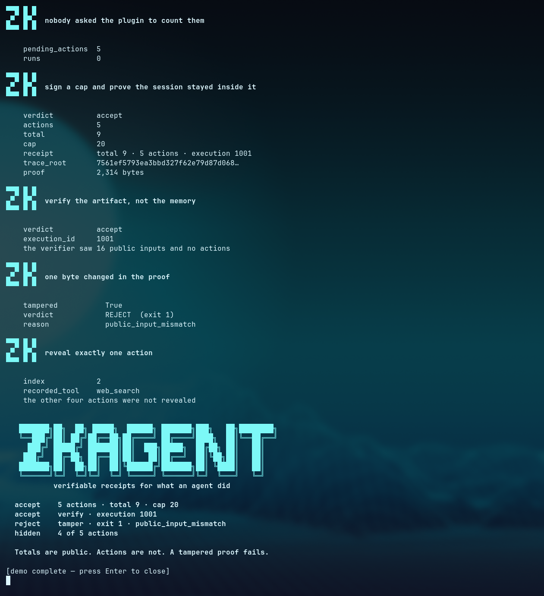

# Catalog submission — `zkagent-attest`

## What it is

A Hermes plugin that gives a session a receipt a third party can check.

Every tool call is recorded in a ledger with its cost and a 64-bit digest of its
arguments. Four tools and one hook let the agent, or the person running it, turn
that ledger into a policy-bound proof:

| Tool | What it does |
| --- | --- |
| `zkagent_status` | pending action count, runs, last attestation |
| `zkagent_attest` | signs a policy (spend cap, action cap, expiry) and proves the session stayed inside it |
| `zkagent_verify` | verifies a receipt, or the whole session with `session: true` |
| `zkagent_disclose` | reveals exactly one action's digest plus its inclusion path |

Hook: `post_tool_call` records target id, cost and a digest of the canonical
arguments. Arguments are hashed, never stored.

The proof is Groth16 over BN254, 7,442 constraints, format 3. A verifier learns
the totals, the action count and that the session stayed under the cap. It does
not learn what the agent did. One action can be revealed afterwards, with a path
that proves it belongs to the attested set.

## Why it needs to be a plugin and not a skill

The value is the verifier, not the prompt. A skill can tell an agent to keep a
log; it cannot produce an artifact that a third party checks without trusting
the agent. This plugin owns four tools, keeps state across a session, and drives
a proving binary. That is what the catalog is for.

## Install

```bash
hermes plugins install zkagent-attest
```

The plugin does not bundle a binary. On first use it runs the pinned installer,
which downloads `zkagent` **v0.4.0+2026-11-08** from
`MCPVOT/zkagent` releases, checks it against a sha256 compiled into the
installer, and installs it to the Hermes cache. `ZKAGENT_BIN` overrides the
path if you already have the binary.

Platforms: Linux x86_64, macOS aarch64, Windows x86_64.

## What the plugin touches

- **No network.** The plugin itself makes no requests. The installer does, once,
  to fetch the pinned binary.
- **No credential reads.** It does not open `.env`, `auth.json`, keyrings or any
  file outside its own data directory.
- **Writes** are confined to `plugin-data/zkagent-attest/`: ledger, pending
  actions, receipts, keys, run artifacts.
- **One subprocess**, `zkagent`, invoked with an argument vector and no shell.
- **No bundled executables.** The catalog artifact is Python source only.
- **No core override.** Nothing in Hermes is patched or monkey-patched.

## Replay protection covers both modes

The seen ledger records what has been accepted. An execution id claimed by verifying a single
receipt now blocks the aggregate, and an execution covered by an accepted session blocks a
later single verify, with `reason_code` `execution_already_accepted` and
`already_accepted_in_session` respectively. Two guard tests pin both orders, because the
first version of this plugin accepted the same work once as a receipt and again inside its
session.

## A judge can check a receipt without trusting us

`examples/verify-it-yourself/` contains a real policy, receipt, proof, the public `keys/vk.bin`, and
a copy of the proof with one hex character changed. One script downloads the pinned release, checks
it against `SHA256SUMS`, and shows all three outcomes:

```bash
cd examples/verify-it-yourself && ./verify-it-yourself.sh
```

```
== checksum ok: c678fa1a…da4e81
== 1. the real proof        {"verdict":"accept"}                                   exit 0
== 2. tampered proof        {"reason_code":"public_input_mismatch","verdict":"reject"}  exit 1
PASS: the receipt verifies, and the tampered copy does not.
```

`docs/VERIFY-IT-YOURSELF.md` states what that establishes and what it cannot: the ledger is
agent-authored, so a receipt is not a complete account of what an agent did, and the trusted setup
is single-party.

## Evidence

- Security audit with 15 findings and their evidence:
  `docs/SECURITY-AUDIT.md` in `MCPVOT/hermes-zkagent`.
- Gates: `python3 scripts/check.py` and `hermes plugins validate . --install-deps`.
- Smoke test drives the real binary: five recorded calls, attest accept, verify
  accept, a one-byte tamper rejected with `public_input_mismatch`, replay
  refused, session aggregate verified.
- Upstream library: `MCPVOT/zkagent`, MIT, 156 tests passing on master.
- Desktop integration: `MCPVOT/omarchy-zkagent`, the Omarchy bar widget, installable with
  `omarchy plugin add https://github.com/MCPVOT/omarchy-zkagent.git --enable`.

## Disclosures and accepted risks

Restated here in full, because a reviewer should not have to open the repo to
learn them:

1. **Single-party trusted setup.** The proving and verifying keys come from a
   setup run by this project. There was no multi-party ceremony. A malicious
   key generator could forge proofs. This is development-grade and is documented
   as such.
2. **The agent writes its own ledger.** The proof is arithmetic over the actions
   the hook recorded. It does not prove the agent recorded everything, or that
   the recording is honest. An agent that skips the hook produces a smaller
   honest receipt. What the proof buys is privacy and non-tampering after the
   fact, not omniscience.
3. **Disclosed digests can be brute-forced.** A disclosure reveals a digest of
   arguments, not the arguments. For low-entropy arguments, a guess can be
   confirmed against the digest. Disclose only what you are willing to have
   guessed.
4. **Replay protection is local.** It refuses a receipt the same installation has
   already accepted, recorded in `seen.json`. It is not a global nullifier and
   does not stop a second machine accepting the same receipt.
5. **Eight actions per receipt.** A receipt covers at most eight actions; longer
   sessions are attested in batches. Verification of the aggregate session index
   binds the receipts to a total, so a missing batch is detectable.
6. **The spend figures are what the hook assigned.** Cost per tool is a table in
   the plugin settings, visible and editable. The cap is enforced against those
   numbers, which are a policy input, not a measurement of real spend.
7. **Verification is local too.** `zkagent_verify` checks the artifact against
   the keys on disk. A verifier who does not trust those keys should compare the
   session root out of band.

## Demo

24 seconds, recorded on the pinned release, no audio needed: https://x.com/MCPVOT/status/2119241113760649642

It shows, in order: banner, five
recorded calls, `accept · actions 5 · total 9 · cap 20`, verify accept, one byte
changed in the proof -> `REJECT` with exit 1 and `public_input_mismatch`, then
one action disclosed while four stay hidden.



The closing frame of that run: every beat carries the ZK mark, and the wordmark sits
above the four verdicts.

## Checklist

- [x] Pinned at the commit that contains the replay fix (0.5.2)
- [x] Plugin manifest validates (`hermes plugins validate . --install-deps`)
- [x] No bundled executables
- [x] No core override
- [x] No secret reads, no network from the plugin
- [x] MIT licensed
- [x] Security audit published
- [x] Disclosures restated in this description
- [x] Demo video: https://x.com/MCPVOT/status/2119241113760649642
