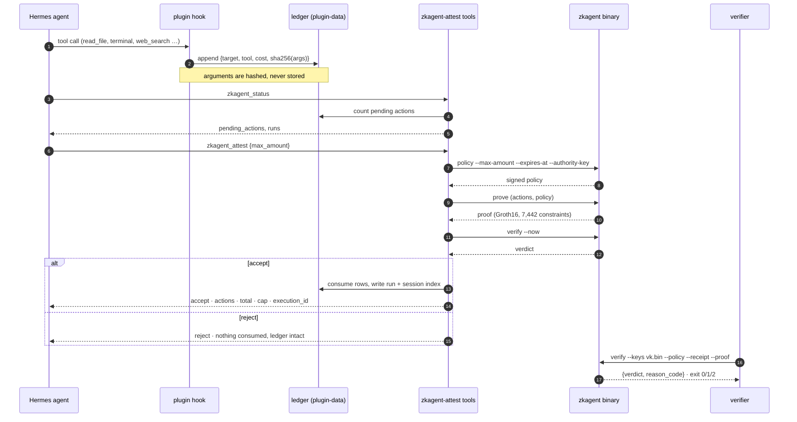
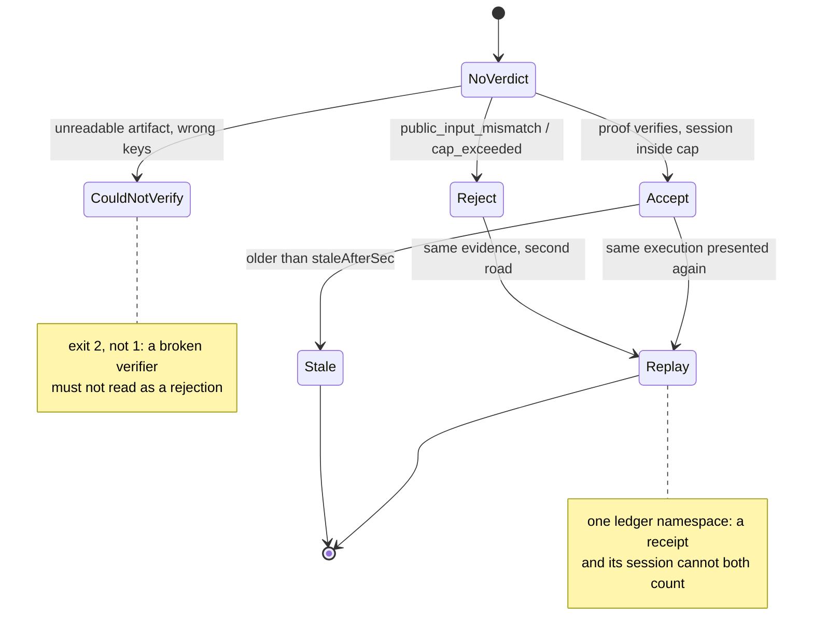

# Diagrams

Three views of the same system: what happens during a session, what a verdict can be, and which
program owns which file. If a diagram and the code disagree, the code is right and the diagram is a
bug — open an issue.

## 1. One attestation, end to end



## 2. What a verdict can be



## 3. Who owns which file

```mermaid
flowchart LR
    subgraph Hermes
        AG[agent turn] --> HOOK[post_tool_call hook]
        TOOLS[4 tools] --> SVC[plugin __init__.py]
    end
    HOOK --> LEDGER[(state.json + pending.jsonl)]
    SVC --> LEDGER
    SVC --> SEEN[(seen.json · replay guard)]
    SVC --> RUNS[(runs/run-N/{policy,receipt,proof}.json)]
    SVC -->|subprocess, no shell| BIN[zkagent binary]
    BIN --> REL[[release v0.4.1+2026-11-08<br/>sha256-pinned]]
    RUNS --> VERDICT[(last-verdict.json)]
    VERDICT --> WIDGET[Omarchy bar widget<br/>mcpvot.attest · ZK mark]
    SVC -.->|never| NET[no network]
    SVC -.->|never| SECRETS[no .env, no keys]
```

## Reading order

1. this file, for the shape
2. `docs/ARCHITECTURE.md`, for the decisions
3. `CONSTITUTION.md`, for the rules that outrank convenience
