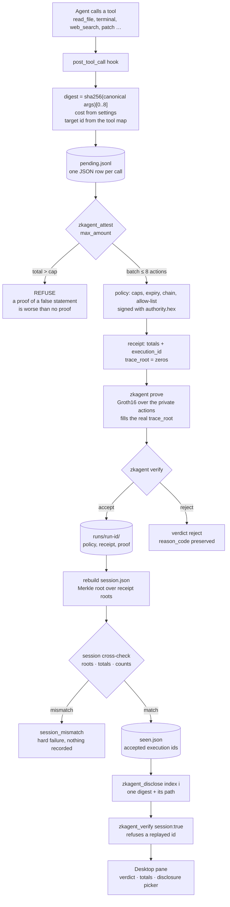

# Flow: from a tool call to a verifiable receipt

The whole product in one diagram. Every arrow is something that actually runs; nothing here
is aspirational.



## The three refusals are the product

| Refusal | When | Why it matters |
|---|---|---|
| `max_amount` exceeded | the session spent more than the cap you asked to prove | a proof of a false statement is worse than no proof |
| `session_mismatch` | the index disagrees with the receipt files | an aggregate that cannot lie about its members |
| `replay` | an execution id was already accepted | a proof is not a subscription; once is the contract |

## Where the secrets are

`authority.hex` (0600) signs policies, `keys/` (0700) holds the circuit keys, and the actions
never leave `actions.json` inside the run directory. A disclosure reveals one 64-bit digest
and three sibling hashes. The arguments themselves are never written anywhere.

## What each stage costs, measured on this laptop

```
hook            0.051 ms per tool call        (append, no read-modify-write)
attest          0.6 s once per batch          (prove 0.44-0.63 s + verify 11 ms)
verify          11 ms
disclose        1 ms + one verify             (zero added constraints)
session check   sha256 over ≤ N roots, microseconds
```
